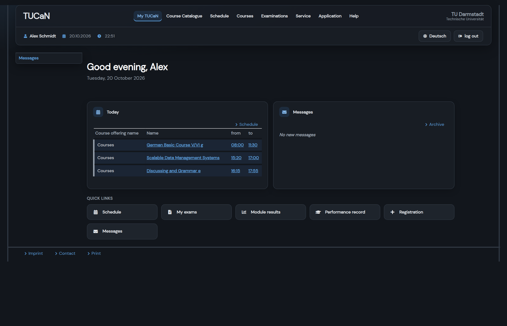
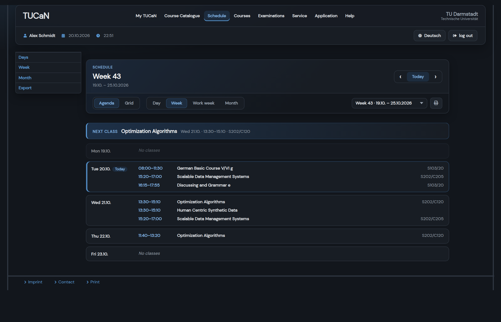
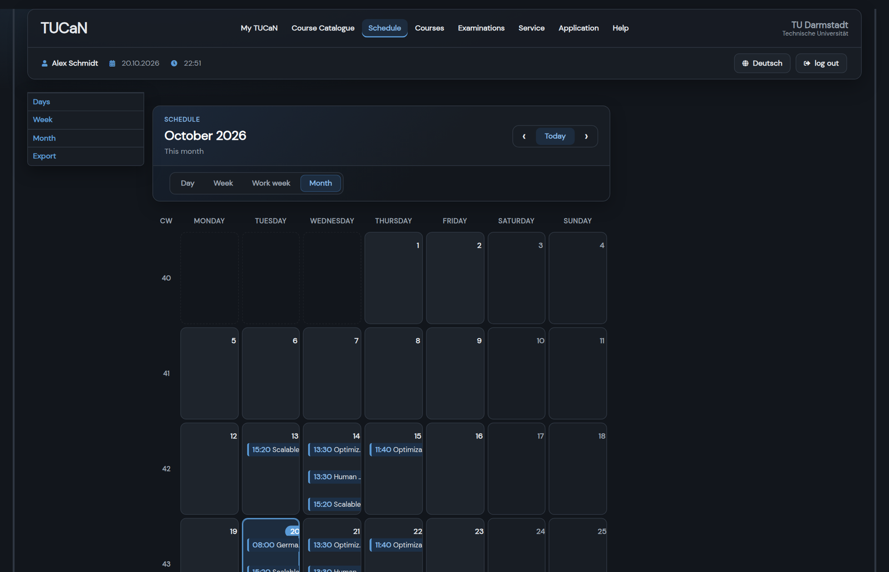
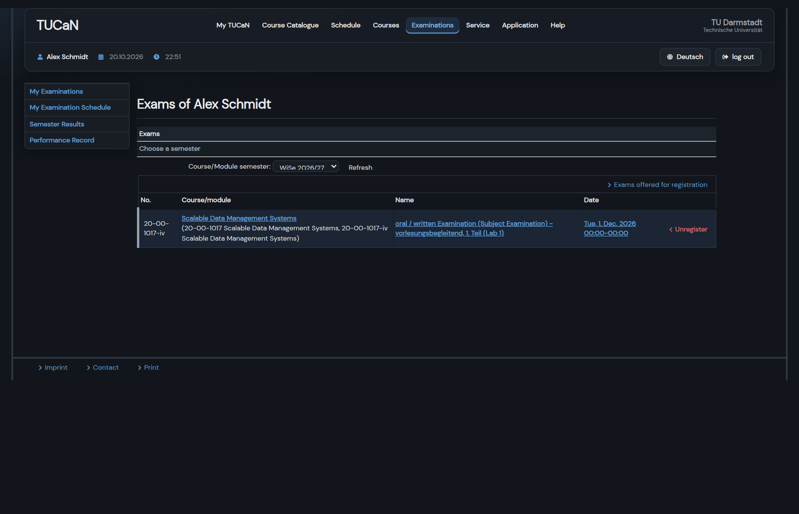
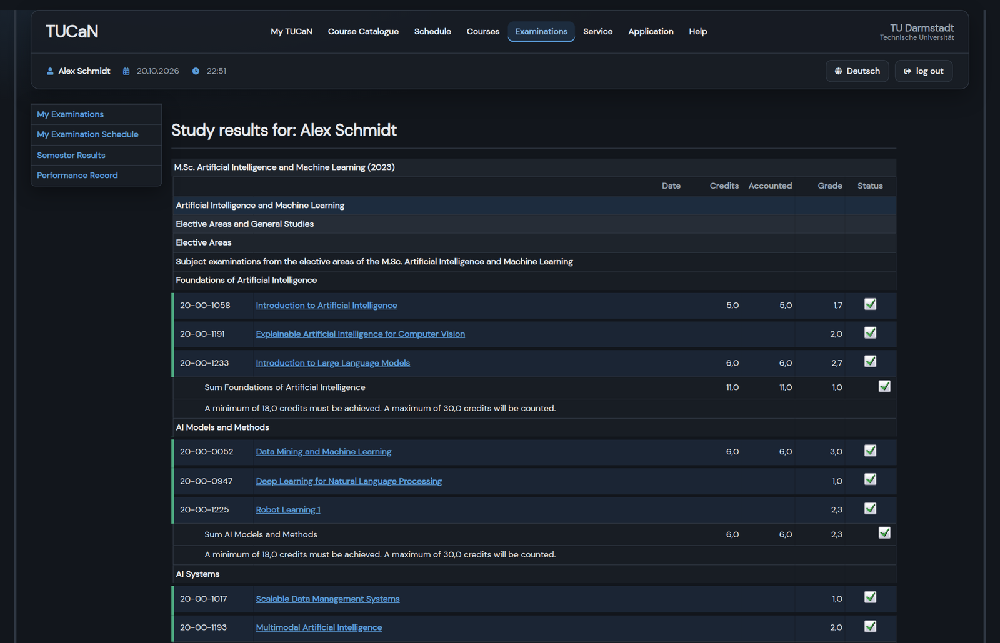
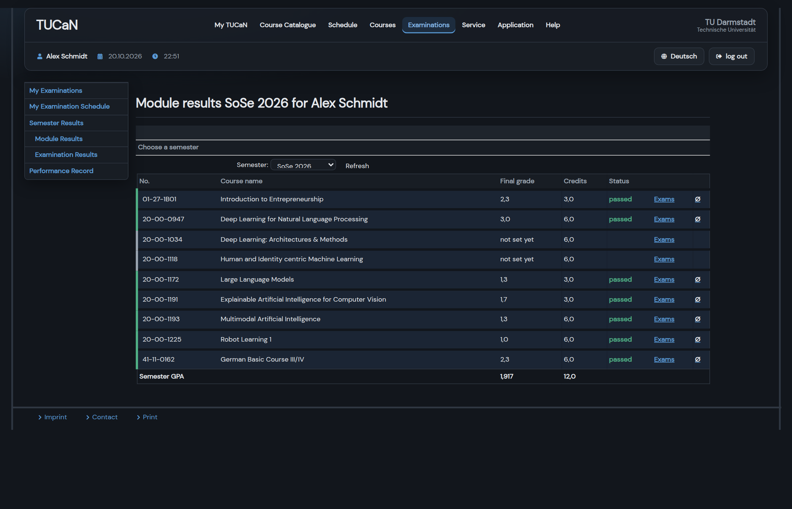
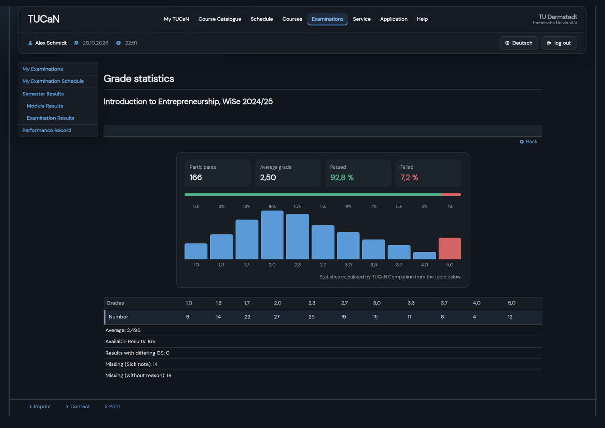
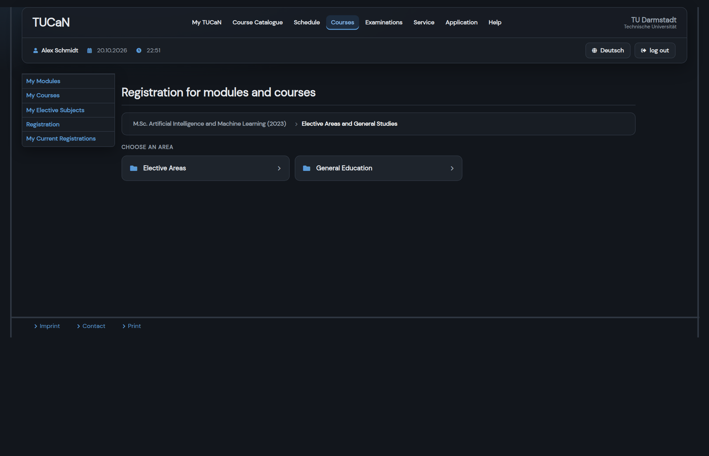
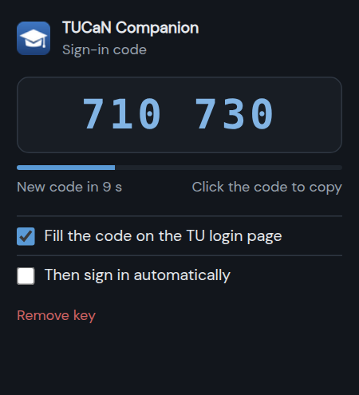
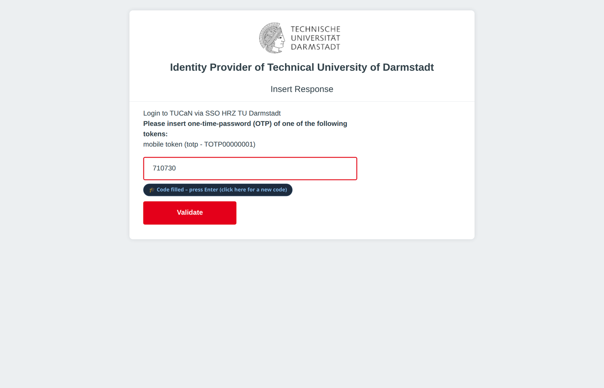

# TUCaN Companion

**A cleaner, darker, English TUCaN for TU Darmstadt students, with automatic sign-in codes.**

TUCaN Companion is a free Chrome extension that redesigns [TUCaN](https://www.tucan.tu-darmstadt.de) in your browser. You get a dark theme, a readable weekly agenda, a calendar-style month view, clearer exam and grade pages and English translations for the German leftovers. It also fills in the 6-digit one-time code on the TU login page.

The repo also contains an optional **AI assistant connector (MCP server)**. With it, assistants such as Claude can answer questions like *"When is my next exam?"* using your TUCaN data, read-only.

> Unofficial student project. Not affiliated with or endorsed by TU Darmstadt. "TUCaN" and "TU Darmstadt" are names of TU Darmstadt. The extension only changes how pages look in **your** browser and sends no data anywhere.



---

## Contents

- [Features](#features)
- [Install the extension](#install-the-extension)
- [How to use it](#how-to-use-it)
  - [Schedule](#schedule)
  - [Month view](#month-view)
  - [Exams](#exams)
  - [Grades and performance record](#grades-and-performance-record)
  - [Grade statistics](#grade-statistics)
  - [Registration](#registration)
  - [Sign-in codes (2FA)](#sign-in-codes-2fa)
- [Privacy and security](#privacy-and-security)
- [AI assistant connector (MCP)](#ai-assistant-connector-mcp)
- [Troubleshooting](#troubleshooting)
- [Development](#development)
- [Credits and licenses](#credits-and-licenses)

---

## Features

| | |
|---|---|
| 🌙 **Dark theme** | Calm dark colours, rounded cards, the DM Sans font and a tidy two-row header on every TUCaN page. |
| 📅 **Agenda schedule** | This week as a list per day with full course names, rooms and a "next class" banner. One click switches back to the classic grid. |
| 🗓️ **Month calendar** | Real calendar tiles, today highlighted, entries with time and full course name. |
| 📝 **Exams** | Each exam on its own row, with the module code as a tag and the sitting (1st/2nd/special) written out. Registered exams show a ✓ badge, past dates are dimmed. |
| 🎓 **Results** | Passed, incomplete and failed modules get a green, amber or red edge. Status words move into the status column. |
| 📊 **Grade statistics** | The grade distribution popup gets participants, average, pass rate and a bar chart. |
| 🧭 **Registration** | A short breadcrumb, area cards, course cards with codes, deadline countdowns ("5 days left") and big Register buttons. |
| 🇬🇧 **English everywhere** | German leftovers (*unvollständig*, *Wahlbereiche*, *Krankschreibung* …) translated, with the original German on hover. |
| 🔐 **Sign-in codes** | Shows your TU one-time code in the toolbar and fills it in on the login page automatically. |
| 🤖 **AI connector** *(optional)* | Ask an AI assistant about your schedule, exams and grades. Read-only. |

---

## Install the extension

### Option A: Chrome Web Store *(recommended, once published)*

1. Open the TUCaN Companion page in the Chrome Web Store.
2. Click **Add to Chrome → Add extension**.
3. Open TUCaN. That's it, and updates install automatically.

*The store listing is in review. Until it's live, use option B.*

### Option B: Install from GitHub (2 minutes)

1. Download **`tucan-companion-extension.zip`** from the [latest release](../../releases/latest) and **unzip** it.
2. Open **`chrome://extensions`** in Chrome (or Edge, Brave, Vivaldi …).
3. Turn on **Developer mode** (top right).
4. Click **Load unpacked** and select the unzipped folder (the one that contains `manifest.json`).
5. Optional: click the puzzle icon 🧩 in the toolbar and **pin** TUCaN Companion.
6. Open or reload [TUCaN](https://www.tucan.tu-darmstadt.de).

**Updating:** download the new zip, replace the folder's contents, then click ↻ **Reload** on the extension's card in `chrome://extensions`.

---

## How to use it

Everything happens automatically on TUCaN pages. Below is what changes and how to use the new controls. All screenshots use a made-up student ("Alex Schmidt") with fake grades.

### Schedule

`Schedule → Week`



- **Agenda / Grid** switches between the day-by-day list and TUCaN's classic timetable. Your choice is remembered.
- **‹ Today ›** moves between weeks. You can also use the **← / →** keys on your keyboard.
- **Day · Week · Work week · Month** change the view, and the **week picker** on the right jumps to any week.
- **Next class** shows what's coming up, for example *Optimization Algorithms, Wed 13:30, S202/C120*.
- In the grid, empty early and late hours are hidden. Click **Show full day** to see them.
- If you open the schedule on a week that isn't the current one, it jumps to today automatically.

### Month view

`Schedule → Month`



Each day is a tile with its classes, for example *15:20 Scalable Data Management Systems*. Today is outlined, and weekends are slightly dimmed. Click a day number to open that day.

### Exams

`Examinations → My Examinations`



Each exam shows its module code, the full name and date. **Unregister** is shown in red so you can't mistake it for a link.

### Grades and performance record

`Examinations → Performance Record` and `Semester Results → Module Results`





- The **coloured left edge** shows the status of each module: 🟩 passed, 🟧 incomplete, 🟥 failed.
- The hierarchy (study programme → area → module) is shaded from dark to light.
- Statuses like *Krankschreibung* (sick note) appear in the status column, not in place of the grade.

### Grade statistics

Click **Ø** next to a module in *Module Results*.



You see the number of participants, the average grade, the pass and fail rates and a bar chart of the grade distribution. Failed grades are shown in red.

### Registration

`Courses → Registration`



- The long chain of links becomes a short **breadcrumb**. Click **…** to show the full path.
- Areas are shown as **cards**. Courses show their **code**, **title** and **semester**.
- Deadlines get a **countdown**: green *"23 days left"*, amber *"3 days left"*, grey *"Closed"*.
- **Register** is a green button and **Deregister** a red outline button. The **Next** button is repeated at the bottom of long forms.

### Sign-in codes (2FA)

TU's login asks for a 6-digit code from an authenticator app. TUCaN Companion can generate that code for you and fill it in.

 



**1. Get your token's secret key.** The code is calculated from a secret key, which you see once, when you add a token. You have two options:

- **Add a new token** *(easiest)*. On the TU login page click **2FA-Management**, add a new **TOTP** token and copy the key shown next to the QR code (`JBSW Y3DP …` or a link starting `otpauth://`). Also scan the QR code with your phone app, so your phone keeps working too.
- **Reuse the token already in Google Authenticator.** In the app go to ☰ → **Transfer accounts → Export accounts**, choose only the TU entry, and read the QR code with one of these:
  - the [AI connector's setup](#setup), which scans with your webcam and prints the `otpauth://` link, or
  - any desktop authenticator that imports Google exports (e.g. the open-source *Authenticator* extension: ⚙ → Backup shows the link).

**2. Save it.** Click the TUCaN Companion icon in the toolbar, paste the key or link and click **Save key**. The popup now shows the current code with a countdown. **Click the code to copy it.** Check that it matches your phone.

**3. Log in as usual.** On the code step the extension fills in the field and shows *"Code filled – press Enter"*.

**Options in the popup:**

| Option | What it does |
|---|---|
| **Fill the code on the TU login page** | On by default. Turn it off to fill only when you click the blue chip. |
| **Then sign in automatically** | Off by default. Also presses *Validate*. At most once a minute, so a wrong key can never lock your account with repeated failed attempts. |
| **Remove key** | Deletes the key from Chrome. Click twice to confirm. |

> ⚠️ **Security trade-off:** two-factor login is meant to need *two devices*. With the key in your browser, anyone who can use your browser profile (or a malicious extension) can produce codes. The key is stored only in your Chrome profile, unencrypted. Only use this on your own computer, and never share the key, a screenshot of it or the QR code.

---

## Privacy and security

- **No data leaves your computer.** The extension makes **no network requests** of its own: no analytics, no servers, no tracking. It only changes how TUCaN pages look, locally.
- **It only runs on** `www.tucan.tu-darmstadt.de` (theme), `dsf.tucan.tu-darmstadt.de` (logout page styling) and `login.tu-darmstadt.de` (code filling).
- **Permissions:** `storage`, to remember your view choice and your sign-in key (if you add one), and `clipboardWrite`, so clicking the code copies it.
- **Open source:** everything is in this repo. Read it, or build it yourself.

Full policy: [PRIVACY.md](PRIVACY.md).

---

## AI assistant connector (MCP)

An optional, separate tool in [`mcp/`](mcp/). It lets AI assistants that support the **Model Context Protocol**, such as Claude Code or Claude Desktop, read your TUCaN data and answer questions about it.

**It's read-only:** it can't register, deregister or change anything. Register, deregister, unregister and logout links are never offered to the assistant, and it doesn't submit forms except the semester dropdown.

### Requirements

- Linux, macOS or Windows with [**uv**](https://docs.astral.sh/uv/) (`curl -LsSf https://astral.sh/uv/install.sh | sh`)
- Your TU-ID, password and TOTP secret key (see [Sign-in codes](#sign-in-codes-2fa))

### Setup

```bash
git clone https://github.com/rahul069/tucan-companion.git
cd tucan-companion/mcp
uv run tucan-mcp-setup              # asks for the key, TU-ID and password, then tests the login
```

To read the key from Google Authenticator's export QR code with your webcam instead of typing it:

```bash
uv run tucan-mcp-setup --webcam --show-link
```

`--show-link` also prints the `otpauth://` link, so you can paste it into the extension's popup. Run `clear` afterwards.

Your login is stored in the **system keyring** (GNOME Keyring, macOS Keychain or Windows Credential Manager), never in a file.

**Connect it to Claude Code:**

```bash
claude mcp add tucan -s user -- uv run --directory /path/to/tucan-companion/mcp tucan-mcp
```

**Or Claude Desktop** (`claude_desktop_config.json`):

```json
{
  "mcpServers": {
    "tucan": {
      "command": "uv",
      "args": ["run", "--directory", "/path/to/tucan-companion/mcp", "tucan-mcp"]
    }
  }
}
```

### Example questions

> **You:** What's on my schedule next week?
>
> **Assistant:** *(calls `tucan_schedule(week_offset=1)`)*
> **Week 44 · 26.10. – 01.11.2026**
> - **Tue:** 08:00–11:30 German Basic Course (S103/20) · 15:20–17:00 Scalable Data Management Systems (S202/C205)
> - **Wed:** 13:30–15:10 Optimization Algorithms (S202/C120)
> - **Thu:** 11:40–13:20 Optimization Algorithms (S202/C120)

> **You:** When is my exam for Scalable Data Management?
>
> **Assistant:** *(calls `tucan_exams()`)* Tuesday, 1 December 2026. It's the oral/written exam, part 1 (Lab 1), and you're registered.

Other things to ask:
- *"Summarise my grades from SoSe 2026 and my average."*
- *"Which modules are still incomplete?"*
- *"Do I have new TUCaN messages?"*
- *"What's the registration deadline for Deep Learning?"*

### Tools

| Tool | Returns |
|---|---|
| `tucan_overview` | Today's appointments and new messages |
| `tucan_schedule(week_offset)` | Classes for a week, per day (0 = this week) |
| `tucan_month(month_offset)` | Month calendar |
| `tucan_exams(semester)` | Registered exams with dates |
| `tucan_module_results(semester)` | Module grades and credits |
| `tucan_exam_results(semester)` | Individual exam results |
| `tucan_performance_record` | Full performance record and averages |
| `tucan_my_modules(semester)` / `tucan_my_courses(semester)` | Enrolled modules and courses |
| `tucan_registrations` / `tucan_registration_offers` | Current registrations, registration areas |
| `tucan_messages` | Inbox |
| `tucan_menu` / `tucan_open(name)` | Any TUCaN menu page |
| `tucan_follow(n)` | Open link `[n]` from the previous page (a module, a message …) |

`semester` is optional, e.g. `"WiSe 2026/27"` or `"SoSe 2026"`.

**Commands:** `uv run tucan-mcp-setup --test` re-tests the login. `uv run tucan-mcp-setup --forget` deletes the saved login and the session.

> Data the connector reads (e.g. your grades) is sent to the AI service you use when it answers you. Only ask about what you're comfortable sharing with that service.

---

## Troubleshooting

| Problem | Fix |
|---|---|
| TUCaN looks unchanged | Check the extension is enabled in `chrome://extensions`, then reload the page. It only runs on `https://www.tucan.tu-darmstadt.de`. |
| The code isn't filled in | Open the popup: is a key saved, and does its code match your phone? If not, remove the key and add it again. |
| "The key contains … which is not valid" | Paste the whole `otpauth://…` link, or only the key. Spaces and line breaks are fine. |
| Code rejected on login | Your computer's clock may be off. Turn on automatic time sync. Also make sure you chose the same token on the login page ("Choose new Token"). |
| Something looks broken after a TUCaN update | [Open an issue](../../issues) with a screenshot. Hide your name and grades first. |
| MCP: "Login failed" | Run `uv run tucan-mcp-setup --test` and read the message. Wrong password and wrong code are reported separately. |

---

## Development

```
extension/          Chrome extension (Manifest V3)
  manifest.json
  css/style.css     theme and styles for the generated components
  css/popup.css     toolbar popup
  js/header.js      two-row header
  js/schedule.js    week agenda/grid and controls
  js/month.js       month calendar
  js/exams.js       exam page
  js/results.js     result rows, status colours, light-page fallback
  js/grades.js      grade statistics
  js/registration.js
  js/home.js        start page
  js/translate.js   German → English
  js/totp.js        one-time codes (RFC 6238)
  js/otp.js         fills the code on login.tu-darmstadt.de
  popup.html, js/popup.js
mcp/                MCP server (Python, uv)
docs/images/        screenshots (fake data)
store/              Chrome Web Store listing text
scripts/build.sh    builds the release zip
```

- **Try changes:** load `extension/` with *Load unpacked*, edit, then click ↻ on the card and reload TUCaN.
- **Build the zip:** `./scripts/build.sh`, which creates `dist/tucan-companion-extension.zip`.
- **Pull requests welcome.** Never commit real student data. Screenshots must use fake data.

---

## Credits and licenses

- Code: **MIT License**, see [LICENSE](LICENSE). © 2026 Rahul Garg.
- Inspired by the idea behind [Better TUCaN](https://github.com/JonasEmrich/Better-TUCaN) by Jonas Emrich. TUCaN Companion is an independent rewrite and contains none of its code.
- Bundled third-party files (see [THIRD_PARTY_NOTICES.md](THIRD_PARTY_NOTICES.md)):
  - [jQuery](https://jquery.com) 3.6.0, MIT
  - [DM Sans](https://fonts.google.com/specimen/DM+Sans), SIL Open Font License 1.1
  - [Font Awesome Free](https://fontawesome.com) 5 (solid), font under SIL OFL 1.1, icons under CC BY 4.0
